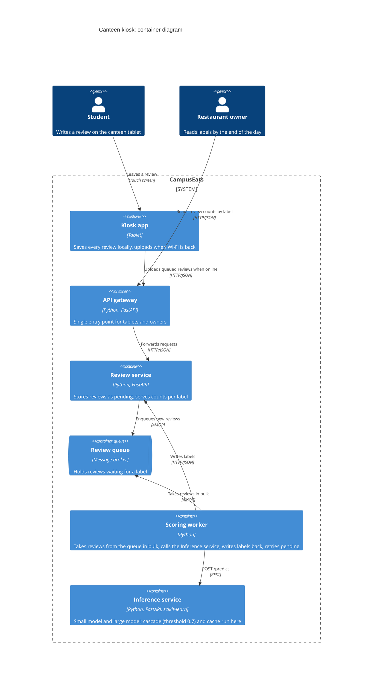

# Task 4: Deployment topologies and trade-offs

**Name / ชื่อ:** Thukdanai Thaothawin

**Student ID / รหัสนิสิต:** 6631319121

This is **individual work**: each student completes and submits their own copy, in their own fork.

*งานนี้เป็น**งานเดี่ยว** นิสิตแต่ละคนทำและส่งงานของตัวเอง ใน fork ของตัวเอง*

**Scenario (A, B or C) / Scenario ที่เลือก:** B (Canteen kiosk)

Choose **one** scenario below. If the last digit of your student ID is odd, take A or B; if it is even, take B or C. Use your measurements from Tutorial 6 as evidence: cite run names from `results/runs.csv`. Answer in Thai or English.

เลือก scenario **หนึ่ง** ข้อด้านล่าง ถ้าเลขตัวสุดท้ายของรหัสนิสิตเป็นเลขคี่ ให้เลือก A หรือ B ถ้าเป็นเลขคู่ ให้เลือก B หรือ C ใช้ผลการวัดจาก tutorial ที่ทำไปเป็นข้อมูลอ้างอิง โดยอ้างชื่อ run จาก `results/runs.csv` จะตอบเป็นภาษาไทยหรือภาษาอังกฤษก็ได้

Facts that hold in every scenario / ข้อเท็จจริงที่ใช้กับทุก scenario:

- The large model serves at most **20 calls per second** (4 calls at once × about 200 ms each), and every call costs money.

  *large model รับได้สูงสุด **20 calls ต่อวินาที** (พร้อมกัน 4 calls × ประมาณ 200 ms ต่อ call) และทุก call มีค่าใช้จ่าย*
- The small model is fast and cheap enough to run anywhere, including inside the review service or on a kiosk, but it is much less accurate on its own.

  *small model เร็วและถูกพอที่จะรันที่ไหนก็ได้ รวมถึงภายใน review service หรือบน kiosk แต่ถ้าใช้ตัวเดียวจะแม่นน้อยกว่ามาก*

## Scenarios

**A. Owner alerts.** When a customer posts a negative review, the restaurant owner gets a push notification within **2 seconds**. At the lunch peak, CampusEats receives **40 reviews per second**. A missed alert is acceptable, but a wrong alert (for example, "your customer is unhappy" when they are happy) makes owners stop trusting alerts and, in the end, ignore them.

*เมื่อลูกค้าโพสต์รีวิวเชิงลบ เจ้าของร้านจะต้องได้รับ push notification ภายใน **2 วินาที** เวลาช่วงพีคตอนเที่ยง CampusEats ได้รับรีวิวจำนวน **40 รายการต่อวินาที** การพลาด alert ไปบ้างนั้นยอมรับได้ แต่ alert ที่ผิด (เช่น "ลูกค้าไม่พอใจ" ทั้งที่จริงๆ แล้วพอใจ) จะทำให้เจ้าของร้านไม่เชื่อถือและเลิกสนใจ alert ในที่สุด*

**B. Canteen kiosk.** A tablet in each canteen lets students leave a review on the spot. However, the canteen Wi-Fi is poor: the tablets lose their connection several times a day, for minutes at a time. The system must accept every review, even while a tablet is offline. Restaurant owners need the labels **by the end of the day**.

*มี tablet ในแต่ละโรงอาหารให้นิสิตรีวิวได้ทันที อย่างไรก็ดี การเชื่อมต่อ Wi-Fi ในโรงอาหารไม่ดี ทำให้ tablet หลุดการเชื่อมต่อวันละหลายครั้ง ครั้งละหลายนาที ระบบจะต้องรับรีวิวได้ทุกรายการแม้ขณะที่กำลัง offline อยู่ และเจ้าของร้านต้องการ label **ภายในสิ้นวัน***

**C. Weekly report.** Restaurant owners want a weekly sentiment report. Nothing in producing this report has to be real-time. **Accuracy matters most** and **cost must be minimal**.

*เจ้าของร้านต้องการรายงาน sentiment รายสัปดาห์ ไม่มีอะไรที่จะต้องทำแบบ real-time ในการออกรายงานนี้ ความแม่นยำ **(accuracy) สำคัญที่สุด** และ **ค่าใช้จ่ายต้องน้อยที่สุด***

## Topologies and patterns to choose from / Topology และ pattern ที่เลือกใช้ได้

| | Topology | Where the model runs / โมเดลรันที่ไหน |
|---|---|---|
| T1 | Model as a service, synchronous | Inference service, called for each review (today's baseline) *inference service ถูกเรียกทุกรีวิว (baseline ของวันนี้)* |
| T2 | Model as a library | Inside the review service, or on the device *ภายใน review service หรือบนอุปกรณ์* |
| T3 | Hybrid | Small model locally, large model as a remote service *small model รันในเครื่อง large model เป็น remote service* |
| T4 | Asynchronous / batch | Reviews are queued (broker, W10) or stored, and scored later in bulk *รีวิวถูกเข้าคิว (broker, W10) หรือเก็บไว้ แล้วติด label ทีหลังเป็นชุด* |

Combine one topology with any of the patterns from Tutorial 6: **fallback**, **cascade** and **cache**.

*เลือก topology หนึ่งแบบ แล้วผสมกับ pattern จาก Tutorial 6 ได้ตามต้องการ: **fallback**, **cascade** และ **cache***

## 1. Quality requirements

The three most important quality requirements for your scenario, each with a number where possible.

*quality requirements ที่สำคัญที่สุด 3 ข้อของ scenario ที่เลือก ระบุตัวเลขเมื่อทำได้*

| # | Quality | Requirement |
|---|---|---|
| 1 | Availability | ระบบรับรีวิวได้ครบ 100% แม้ tablet offline (หลุดหลายนาทีหลายครั้งต่อวัน): ไม่มีรีวิวหาย |
| 2 | Timeliness | เจ้าของร้านได้ label ของรีวิวทุกรายการภายในสิ้นวัน (ไม่ต้อง real-time) |
| 3 | Accuracy และ Cost | label ที่ให้ถูกอย่างน้อย 90% (QR3) โดยเรียก large model ให้น้อยที่สุด |

## 2. Design / การออกแบบ

Your topology, the patterns you add, and a container-level diagram (C4 level 2). The C4 diagram must be written in Mermaid.

*topology ที่เลือก pattern ที่เพิ่ม และ diagram ระดับ container (C4 level 2) เขียนด้วย Mermaid*

Topology ที่เลือกคือ **T4 (asynchronous / batch)** แบบ store-and-forward: tablet เก็บรีวิวไว้ในเครื่องก่อน แล้วส่งขึ้น server เมื่อต่อเน็ตได้ รีวิวถูกเข้าคิว แล้ว scoring worker ติด label เป็นชุดภายในวัน pattern ที่เพิ่ม: **cascade (threshold 0.7)** + **cache** + **fallback** (รีวิวที่ติด label ไม่สำเร็จจะเป็น `pending` แล้วถูกลองใหม่ในรอบถัดไป)

## 3. Evidence / หลักฐาน

Which runs support your choice? Show the numbers and, for scenario A, the capacity arithmetic: how many large-model calls per second does your design need at the peak?

*run ไหนที่สนับสนุนการตัดสินใจของนิสิต ให้นิสิตแสดงตัวเลขประกอบ และสำหรับ scenario A ให้นิสิตแสดงการคำนวณ capacity ด้วย เพื่อแสดงว่าในช่วงพีคนั้น design ของนิสิตต้องใช้ large model กี่ calls ต่อวินาที*

Capacity (ตัวเลขจำนวนรีวิวเป็นข้อสมมติของผม เพราะ scenario B ไม่ได้ระบุ): ถ้ามี 100,000 รีวิวต่อวัน และใช้ cascade 0.7 + cache ที่เรียก large model 38% จะเป็น 100,000 x 0.38 = 38,000 calls ที่ 20 calls/s ใช้ 1,900 s (~32 นาที) ซึ่งเสร็จภายในสิ้นวันสบาย แม้ใช้ large ทุกรีวิวก็ใช้ 100,000 / 20 = 5,000 s (~83 นาที)

| Run | What it shows / แสดงอะไร |
|---|---|
| t0-small | small model อย่างเดียวแม่นแค่ 72.5% ต่ำกว่า QR3 (90%) จึงใช้ตัวเดียวไม่ได้ |
| t0-large | large model ได้ accuracy 93.5% ผ่าน QR3 แต่เรียก large 100% (แพง) |
| t1-before / t1-after | เมื่อ inference ค้าง การรอแบบ synchronous ทำให้เกิด 20 errors (t1-before) ส่วน fallback เก็บรีวิวเป็น pending ได้ 28 รายการโดยไม่มี error เลย (t1-after): รีวิวไม่หาย |
| t2-0.7 | cascade 0.7 ได้ accuracy 93.0% (ใกล้ 93.5%) โดยเรียก large 53% |
| t3-cache | เพิ่ม cache แล้ว large calls ลดเหลือ 38% (cache hits 35%) ที่ accuracy 93.0% เท่าเดิม: cost ต่ำที่สุดที่ยังผ่าน QR3 |

## 4. ADR

Use the ADR format from W5.

*ใช้รูปแบบ ADR จาก W5*

**Title:** ใช้ asynchronous/batch scoring พร้อม store-and-forward สำหรับ canteen kiosk

**Status:** Proposed

**Context:** Tablet ในโรงอาหารหลุดการเชื่อมต่อวันละหลายครั้ง ครั้งละหลายนาที ระบบต้องรับรีวิวทุกรายการ และเจ้าของร้านต้องการ label ภายในสิ้นวันเท่านั้น (ไม่ต้อง real-time) จากการวัด small model อย่างเดียวแม่นแค่ 72.5% (`t0-small`) ส่วน large model แม่น 93.5% แต่ทุก call เสียเงินและรับได้สูงสุด 20 calls/s (`t0-large`)

**Decision:** ใช้ T4: tablet เก็บรีวิวในเครื่องแล้วอัปโหลดเมื่อต่อเน็ตได้ รีวิวถูกเก็บเป็น `pending` และเข้าคิว จากนั้น scoring worker ดึงรีวิวจากคิวแล้วเรียก inference service (`POST /predict`) เป็นชุดตลอดวัน โดย cascade (threshold 0.7) และ cache ทำงานอยู่ใน inference service (ตั้งค่าผ่าน `/admin/config`) ส่วน fallback คือ worker ลองใหม่รอบถัดไปถ้า inference ล้มเหลว

**Consequences:**
- Positive: รับรีวิวได้ 100% แม้ offline และเป็น pending เมื่อ inference ช้า (`t1-after`: 0 errors) ไม่ผูกกับ latency ของ large model, accuracy 93.0% ผ่าน QR3 ด้วย large calls เพียง 38% (`t3-cache`) เทียบกับ 100% (`t0-large`), และ capacity 20 calls/s พอเหลือเฟือเมื่อทำเป็น batch
- Negative: label ไม่ real-time (เห็นช้าสุดภายในสิ้นวัน) ต้องดูแลคิวและ scoring worker เพิ่ม และ cache ต้องมี version ของโมเดลใน key เพื่อไม่ให้คำตอบเก่าค้างเมื่อเปลี่ยนโมเดล

**Alternatives considered:** T1 (model as a service แบบ synchronous): ไม่เลือก เพราะ tablet ที่ offline เรียก inference ไม่ได้ ทำให้รับรีวิวไม่ได้ และเมื่อ inference ช้าจะค้างแบบ `t1-before` (20 errors) T2 (small model บน tablet อย่างเดียว) ไม่เลือก เพราะแม่นแค่ 72.5% ต่ำกว่า 90% ที่ต้องการ
